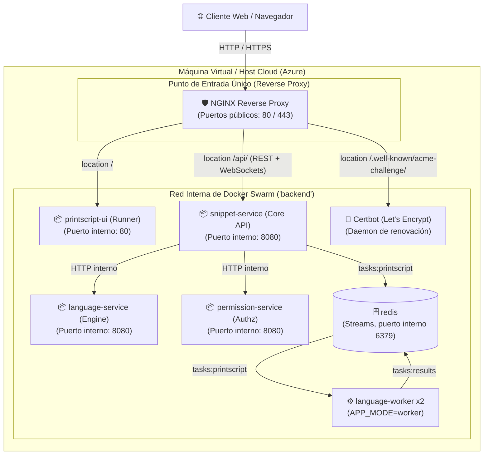

# Snippet Searcher - Infraestructura y Reverse Proxy

Repositorio central de orquestación, infraestructura de red y proxy reverso (Ingress) para el sistema **Snippet Searcher**.

---

## 1. Arquitectura de Red y Topología de Servicios

Siguiendo las pautas de las **Clases 05 (Docker Swarm)**, **06 (HTTPS)** y **07 (Reverse Proxy)**:



### Ventajas del Esquema de Ingress:
1. **Un solo puerto expuesto:** Solo el NGINX Reverse Proxy expone puertos al mundo exterior. Ningún microservicio de backend ni base de datos abre puertos en el host.
2. **Cero fricción de CORS (Same-Origin):** La UI y las APIs de backend se sirven bajo el mismo dominio/origen, eliminando preflights y bloqueos de seguridad del navegador.
3. **WebSockets habilitados:** Configuración optimizada con `Upgrade` y `Connection` para soportar la terminal interactiva de ejecución de PrintScript (US #10).
4. **Desacoplamiento total:** Cada microservicio (`printscript-ui`, `snippet-service`, etc.) produce su propio artefacto/imagen Docker y se orquesta declarativamente aquí.

---

## 2. Estructura del Repositorio

```
snippet-searcher-infra/
├── nginx/
│   ├── conf.d/
│   │   ├── default.conf         # Configuración base HTTP y ruteo (/ y /api/)
│   │   └── ssl.conf.template    # Plantilla HTTPS con terminación TLS Let's Encrypt
│   └── errors/
│       ├── 404.html             # Página de error corporativa 404
│       └── 502.html             # Página de error 502 (Bad Gateway / upstream caído)
├── scripts/
│   └── init-letsencrypt.sh      # Script de inicialización de certificados con DuckDNS
├── docker-stack.yml             # Despliegue en Docker Swarm (Overlay network + Swarm Configs)
├── docker-compose.yml           # Despliegue local para desarrollo sin Swarm
├── .env.example                 # Variables de entorno y tags de imágenes
└── README.md
```

---

## 3. Guía de Ejecución

### Opción A: Desarrollo Local (Docker Compose)
Para probar todo el entorno en tu máquina local sin necesidad de inicializar un cluster Swarm:

1. Configurar variables de entorno:
   ```sh
   cp .env.example .env
   ```
2. Levantar los servicios:
   ```sh
   docker compose up -d
   ```
3. Acceder a:
   * **Frontend:** `http://localhost/`
   * **API de Snippets:** `http://localhost/api/`

### Variables de Auth0

Se definen en `.env` (ver `.env.example`) y las consumen `docker-compose.yml` y `docker-stack.yml`:

| Variable | Servicio | De dónde sale en Auth0 |
|---|---|---|
| `AUTH0_ISSUER_URI` | snippet-service | `https://<dominio-del-tenant>/` (con la barra final) |
| `AUTH0_AUDIENCE` | snippet-service | *Identifier* de la API (APIs > tu API) |
| `AUTH0_DOMAIN` | permission-service | Dominio del tenant, sin `https://` |
| `AUTH0_MGMT_CLIENT_ID` / `AUTH0_MGMT_CLIENT_SECRET` | permission-service | Aplicación *Machine-to-Machine* autorizada sobre la Management API con el permiso `read:users` |

Flags fijos (no vienen de `.env`):

* compose/stack: `AUTH_HEADER_IDENTITY_ENABLED=false` (snippet-service exige un JWT válido) y `USERS_PROVIDER=auth0` (permission-service).
* `docker-compose.e2e.yml`: `AUTH_HEADER_IDENTITY_ENABLED=true` y `USERS_PROVIDER=none`, así el smoke test sigue identificando usuarios con `X-User-Id` sin necesitar Auth0.

### Redis, workers y streams

El procesamiento asíncrono (lint/format masivo al cambiar reglas, US12/US15) usa **Redis Streams**:

| Servicio | Rol |
|---|---|
| `redis` | `redis:7-alpine` con AOF (`--appendonly yes`), `--maxmemory-policy noeviction` (los streams nunca se desalojan) y volumen `redis_data`. Solo en la red interna: no publica puertos. En e2e usa `tmpfs` y sin AOF. |
| `language-service` | `APP_MODE=web`: solo atiende REST. Recibe `REDIS_URL` por si más adelante publica tareas. |
| `language-worker` | Misma imagen que `language-service` con `APP_MODE=worker`. Consume `tasks:printscript` (consumer group `language-workers`) y publica en `tasks:results`. 2 réplicas en el stack, 1 en compose/e2e. |
| `snippet-service` | Publica una tarea por snippet en `tasks:printscript` y consume `tasks:results`. Lee `REDIS_URL`. |

- `REDIS_URL=redis://redis:6379` en `snippet-service`, `language-service` y `language-worker`.
- Variables opcionales de Language: `REDIS_STREAM_TASKS`, `REDIS_STREAM_RESULTS`, `REDIS_STREAM_GROUP`, `REDIS_STREAM_CONSUMER`.
- **Consumer name:** en el stack, `REDIS_STREAM_CONSUMER=worker-{{.Task.Slot}}` (Swarm expande la plantilla en `environment` al crear cada tarea), así cada réplica tiene un nombre único (`worker-1`, `worker-2`). En compose/e2e es `worker-1`.
- **Memoria (stack):** redis 256M, worker 512M con `JAVA_TOOL_OPTIONS=-XX:MaxRAMPercentage=75` para que la JVM respete el límite.
- **Orden de despliegue:** Redis primero y workers después. En compose se garantiza con `depends_on` + healthcheck. En Swarm `depends_on` se ignora: los workers reintentan hasta que Redis responde (`restart_policy: any`); si es la primera vez, conviene `docker service scale snippet-searcher_language-worker=0` antes y volver a 2 cuando `snippet-searcher_redis` esté `1/1`.
- Inspeccionar los streams: `docker compose exec redis redis-cli XINFO GROUPS tasks:printscript`.

---

### Opción B: Despliegue en Docker Swarm (Producción / VM)
Siguiendo las especificaciones de la **Clase 05** y el repositorio de referencia `austral-ingsis/nginx-docker`:

1. Iniciar Docker Swarm en el nodo Manager (si no está iniciado):
   ```sh
   docker swarm init
   ```
2. Desplegar el stack:
   ```sh
   docker stack deploy -c docker-stack.yml snippet-searcher
   ```
3. Verificar el estado de las réplicas:
   ```sh
   docker stack services snippet-searcher
   docker stack ps snippet-searcher --no-trunc
   ```

> [!NOTE] Inmutabilidad de Swarm Configs
> Los archivos de configuración de NGINX se distribuyen mediante `configs` de Swarm. Si modificas `nginx/conf.d/default.conf` o una página de error, debes **incrementar el sufijo de versión en `docker-stack.yml`** (ej. de `_v1` a `_v2`) antes de volver a ejecutar `docker stack deploy`.

---

## 4. Configuración de HTTPS con DuckDNS y Certbot (Clase 06)

1. Crear un dominio gratuito en [DuckDNS](https://www.duckdns.org) apuntando a la IP pública de tu VM en la nube (ej. `mi-grupo.duckdns.org`).
2. Configurar en `.env`:
   ```env
   DOMAIN=mi-grupo.duckdns.org
   CERTBOT_EMAIL=tu-email@dominio.com
   ```
3. Ejecutar el script de inicialización:
   ```sh
   chmod +x ./scripts/init-letsencrypt.sh
   ./scripts/init-letsencrypt.sh
   ```
4. El contenedor `certbot` renovará automáticamente los certificados cada 12 horas si restan menos de 30 días para su expiración.
