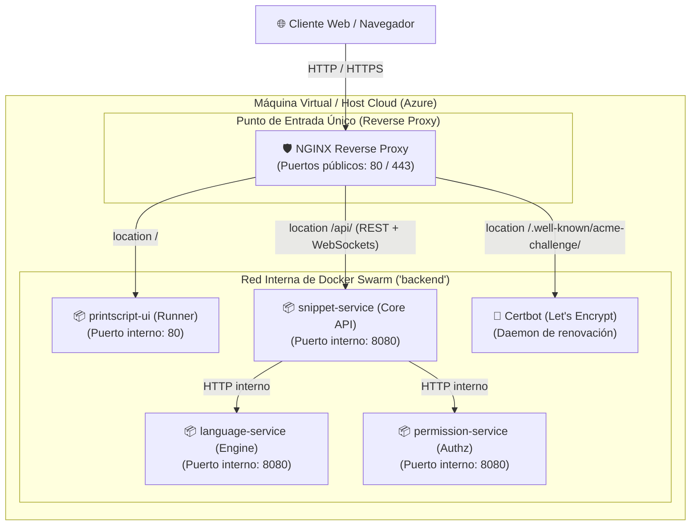

# Snippet Searcher - Infraestructura y Reverse Proxy

Repositorio central de orquestación, infraestructura de red y proxy reverso (Ingress) para el sistema **Snippet Searcher**.

---

## 1. Arquitectura de Red y Topología de Servicios

Siguiendo las pautas de las **Clases 05 (Docker Swarm)**, **06 (HTTPS)** y **07 (Reverse Proxy)**:



### Ventajas del Esquema de Ingress:
1. **Un solo puerto expuesto:** Solo el NGINX Reverse Proxy expone puertos al mundo exterior. Ningún microservicio de backend ni base de datos abre puertos en el host.
2. **Cero fricción de CORS (Same-Origin):** La UI y las APIs de backend se sirven bajo el mismo dominio/origen, eliminando preflights y bloqueos de seguridad del navegador.
3. **WebSockets habilitados:** Configuración optimizada con `Upgrade` y `Connection` para soportar la terminal interactiva de ejecución de PrintScript (US #10).
4. **Desacoplamiento total:** Cada microservicio (`printscript-ui`, `snippet-service`, etc.) produce su propio artefacto/imagen Docker y se orquesta declarativamente aquí.

---

## 2. Estructura del Repositorio

```
snippet-searcher-infra/
├── nginx/
│   ├── conf.d/
│   │   ├── default.conf         # Configuración base HTTP y ruteo (/ y /api/)
│   │   └── ssl.conf.template    # Plantilla HTTPS con terminación TLS Let's Encrypt
│   └── errors/
│       ├── 404.html             # Página de error corporativa 404
│       └── 502.html             # Página de error 502 (Bad Gateway / upstream caído)
├── scripts/
│   └── init-letsencrypt.sh      # Script de inicialización de certificados con DuckDNS
├── docker-stack.yml             # Despliegue en Docker Swarm (Overlay network + Swarm Configs)
├── docker-compose.yml           # Despliegue local para desarrollo sin Swarm
├── .env.example                 # Variables de entorno y tags de imágenes
└── README.md
```

---

## 3. Guía de Ejecución

### Opción A: Desarrollo Local (Docker Compose)
Para probar todo el entorno en tu máquina local sin necesidad de inicializar un cluster Swarm:

1. Configurar variables de entorno:
   ```sh
   cp .env.example .env
   ```
2. Levantar los servicios:
   ```sh
   docker compose up -d
   ```
3. Acceder a:
   * **Frontend:** `http://localhost/`
   * **API de Snippets:** `http://localhost/api/`

---

### Opción B: Despliegue en Docker Swarm (Producción / VM)
Siguiendo las especificaciones de la **Clase 05** y el repositorio de referencia `austral-ingsis/nginx-docker`:

1. Iniciar Docker Swarm en el nodo Manager (si no está iniciado):
   ```sh
   docker swarm init
   ```
2. Desplegar el stack:
   ```sh
   docker stack deploy -c docker-stack.yml snippet-searcher
   ```
3. Verificar el estado de las réplicas:
   ```sh
   docker stack services snippet-searcher
   docker stack ps snippet-searcher --no-trunc
   ```

> [!NOTE] Inmutabilidad de Swarm Configs
> Los archivos de configuración de NGINX se distribuyen mediante `configs` de Swarm. Si modificas `nginx/conf.d/default.conf` o una página de error, debes **incrementar el sufijo de versión en `docker-stack.yml`** (ej. de `_v1` a `_v2`) antes de volver a ejecutar `docker stack deploy`.

---

## 4. Configuración de HTTPS con DuckDNS y Certbot (Clase 06)

1. Crear un dominio gratuito en [DuckDNS](https://www.duckdns.org) apuntando a la IP pública de tu VM en la nube (ej. `mi-grupo.duckdns.org`).
2. Configurar en `.env`:
   ```env
   DOMAIN=mi-grupo.duckdns.org
   CERTBOT_EMAIL=tu-email@dominio.com
   ```
3. Ejecutar el script de inicialización:
   ```sh
   chmod +x ./scripts/init-letsencrypt.sh
   ./scripts/init-letsencrypt.sh
   ```
4. El contenedor `certbot` renovará automáticamente los certificados cada 12 horas si restan menos de 30 días para su expiración.
