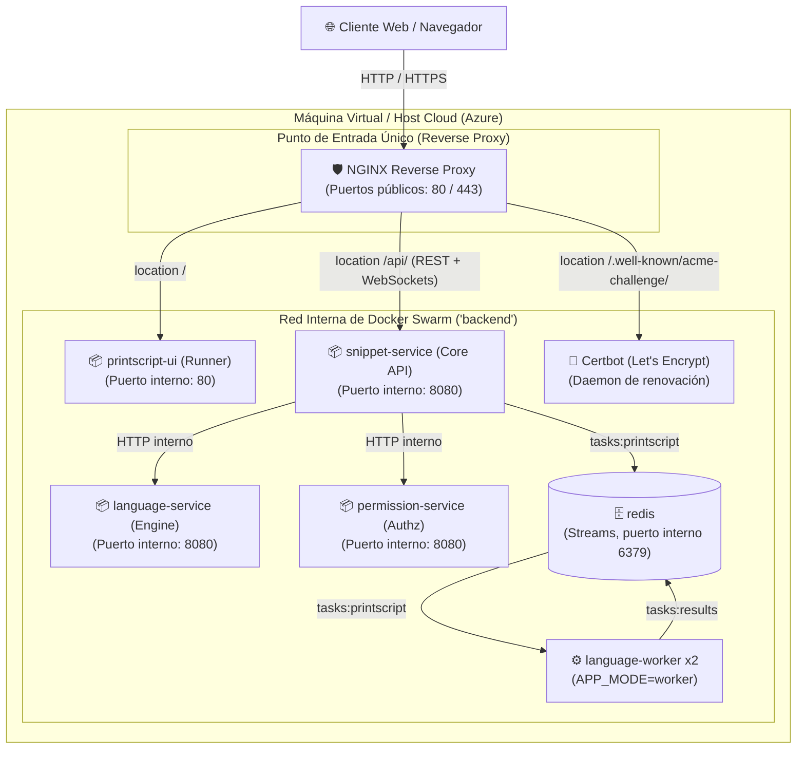

# Snippet Searcher - Infraestructura y Reverse Proxy

Repositorio central de orquestación, infraestructura de red y proxy reverso (Ingress) para el sistema **Snippet Searcher**.

---

## 1. Arquitectura de Red y Topología de Servicios

Siguiendo las pautas de las **Clases 05 (Docker Swarm)**, **06 (HTTPS)** y **07 (Reverse Proxy)**:



### Ventajas del Esquema de Ingress:
1. **Un solo puerto expuesto:** Solo el NGINX Reverse Proxy expone puertos al mundo exterior. Ningún microservicio de backend ni base de datos abre puertos en el host.
2. **Cero fricción de CORS (Same-Origin):** La UI y las APIs de backend se sirven bajo el mismo dominio/origen, eliminando preflights y bloqueos de seguridad del navegador.
3. **WebSockets habilitados:** Configuración optimizada con `Upgrade` y `Connection` para soportar la terminal interactiva de ejecución de PrintScript (US #10).
4. **Desacoplamiento total:** Cada microservicio (`printscript-ui`, `snippet-service`, etc.) produce su propio artefacto/imagen Docker y se orquesta declarativamente aquí.

---

## 2. Estructura del Repositorio

```
snippet-searcher-infra/
├── nginx/
│   ├── conf.d/
│   │   ├── default.conf         # Configuración base HTTP y ruteo (/ y /api/)
│   │   └── ssl.conf.template    # Plantilla HTTPS con terminación TLS Let's Encrypt (usa ${DOMAIN})
│   ├── entrypoint.sh            # Arranque del proxy: renderiza la config y recarga cada 6 h
│   ├── render-conf.sh           # HTTPS si existe el certificado de $DOMAIN, si no HTTP
│   └── errors/
│       ├── 404.html             # Página de error corporativa 404
│       └── 502.html             # Página de error 502 (Bad Gateway / upstream caído)
├── scripts/
│   └── init-letsencrypt.sh      # Script de inicialización de certificados con DuckDNS
├── docker-stack.yml             # Despliegue en Docker Swarm (Overlay network + Swarm Configs)
├── docker-compose.yml           # Despliegue local para desarrollo sin Swarm
├── .env.dev.example             # Plantilla del .env de la VM de dev (tags :dev)
├── .env.prod.example            # Plantilla del .env de la VM de prod (tags :latest)
├── .github/workflows/
│   ├── deploy.yml               # CD: push a dev/main -> docker stack deploy por SSH
│   └── e2e.yml                  # Smoke tests (PRs a main y dev)
└── README.md
```

---

## 3. Guía de Ejecución

### Opción A: Desarrollo Local (Docker Compose)
Para probar todo el entorno en tu máquina local sin necesidad de inicializar un cluster Swarm:

1. Configurar variables de entorno:
   ```sh
   cp .env.dev.example .env
   ```
2. Levantar los servicios:
   ```sh
   docker compose up -d
   ```
3. Acceder a:
   * **Frontend:** `http://localhost/`
   * **API de Snippets:** `http://localhost/api/`

### Variables de Auth0

Se definen en `.env` (ver `.env.dev.example` y `.env.prod.example`) y las consumen `docker-compose.yml` y `docker-stack.yml`:

| Variable | Servicio | De dónde sale en Auth0 |
|---|---|---|
| `AUTH0_ISSUER_URI` | snippet-service | `https://<dominio-del-tenant>/` (con la barra final) |
| `AUTH0_AUDIENCE` | snippet-service | *Identifier* de la API (APIs > tu API) |
| `AUTH0_DOMAIN` | permission-service | Dominio del tenant, sin `https://` |
| `AUTH0_MGMT_CLIENT_ID` / `AUTH0_MGMT_CLIENT_SECRET` | permission-service | Aplicación *Machine-to-Machine* autorizada sobre la Management API con el permiso `read:users` |

Flags fijos (no vienen de `.env`):

* compose/stack: `AUTH_HEADER_IDENTITY_ENABLED=false` (snippet-service exige un JWT válido) y `USERS_PROVIDER=auth0` (permission-service).
* `docker-compose.e2e.yml`: `AUTH_HEADER_IDENTITY_ENABLED=true` y `USERS_PROVIDER=none`, así el smoke test sigue identificando usuarios con `X-User-Id` sin necesitar Auth0.

### Redis, workers y streams

El procesamiento asíncrono (lint/format masivo al cambiar reglas, US12/US15) usa **Redis Streams**:

| Servicio | Rol |
|---|---|
| `redis` | `redis:7-alpine` con AOF (`--appendonly yes`), `--maxmemory-policy noeviction` (los streams nunca se desalojan) y volumen `redis_data`. Solo en la red interna: no publica puertos. En e2e usa `tmpfs` y sin AOF. |
| `language-service` | `APP_MODE=web`: solo atiende REST. Recibe `REDIS_URL` por si más adelante publica tareas. |
| `language-worker` | Misma imagen que `language-service` con `APP_MODE=worker`. Consume `tasks:printscript` (consumer group `language-workers`) y publica en `tasks:results`. 2 réplicas en el stack, 1 en compose/e2e. |
| `snippet-service` | Publica una tarea por snippet en `tasks:printscript` y consume `tasks:results`. Lee `REDIS_URL`. |

- `REDIS_URL=redis://redis:6379` en `snippet-service`, `language-service` y `language-worker`.
- Variables opcionales de Language: `REDIS_STREAM_TASKS`, `REDIS_STREAM_RESULTS`, `REDIS_STREAM_GROUP`, `REDIS_STREAM_CONSUMER`.
- **Consumer name:** en el stack, `REDIS_STREAM_CONSUMER=worker-{{.Task.Slot}}` (Swarm expande la plantilla en `environment` al crear cada tarea), así cada réplica tiene un nombre único (`worker-1`, `worker-2`). En compose/e2e es `worker-1`.
- **Memoria (stack):** redis 256M (con `--maxmemory 200mb`, así rechaza escrituras en vez de morir por OOM), worker 768M con `JAVA_TOOL_OPTIONS=-XX:MaxRAMPercentage=75` para que la JVM respete el límite.
- **Orden de despliegue:** Redis primero y workers después. En compose se garantiza con `depends_on` + healthcheck. En Swarm `depends_on` se ignora: los workers reintentan hasta que Redis responde (`restart_policy: any`); si es la primera vez, conviene `docker service scale snippet-searcher_language-worker=0` antes y volver a 2 cuando `snippet-searcher_redis` esté `1/1`.
- Inspeccionar los streams: `docker compose exec redis redis-cli XINFO GROUPS tasks:printscript`.

### Assets, assets-db y Azurite

El contenido de los snippets vive en **Assets** (blobs en Azure Blob Storage). Servicios nuevos, todos solo en la red interna (sin puertos publicados):

| Servicio | Detalle |
|---|---|
| `assets-service` | Imagen `ASSETS_SERVICE_IMAGE` (`:dev` en dev, `:latest` en prod). Escucha en el puerto 8080. Memoria 512M con `JAVA_TOOL_OPTIONS=-XX:MaxRAMPercentage=75`. El CD del repo Assets despliega `snippet-searcher_assets-service`. |
| `assets-db` | `postgres:16-alpine`, volumen `assets_db_data` (tmpfs en e2e). Credenciales `ASSETS_DB_USER` / `ASSETS_DB_PASSWORD`. |
| `azurite` | `mcr.microsoft.com/azure-storage/azurite:3.34.0`, solo servicio blob (puerto 10000), volumen `azurite_data`, 256M. Siempre presente en el stack. |

- Variables de `assets-service` (los nombres que lee la app): `SPRING_PROFILES_ACTIVE`, `SPRING_DATASOURCE_URL`, `SPRING_DATASOURCE_USERNAME`, `SPRING_DATASOURCE_PASSWORD`, `AZURE_STORAGE_CONNECTION_STRING`, `AZURE_STORAGE_CONTAINER`.
- `snippet-service` recibe `ASSETS_SERVICE_URL=http://assets-service:8080` (lo consumira SNIP-4) y `SNIPPET_STORAGE=assets`, que elige donde guarda el contenido (`assets` o `database`; el default de la app es `database`). Las imagenes viejas de Snippets ignoran ambas variables.
- **Dev y e2e:** `AZURE_STORAGE_CONNECTION_STRING` apunta al host `azurite` (en `.env.dev.example` hay un comentario con la forma de armarla con la cuenta publica de desarrollo de Azurite). El e2e usa una cuenta descartable propia, definida en `docker-compose.e2e.yml`.
- **Prod:** `AZURE_STORAGE_CONNECTION_STRING` en el `.env` de la VM es la de la cuenta real de Azure (paso manual **M7**: crear el storage account y el container, y copiar la connection string desde las Access keys). Assets crea el container si no existe, pero conviene crearlo antes con el mismo nombre que `AZURE_STORAGE_CONTAINER` (`snippets`). En prod `azurite` queda levantado sin uso.
- El smoke e2e todavia no ejercita Assets: solo se verifica que el stack levanta.

---

### Opción B: Despliegue en Docker Swarm (VM dev / prod)
Ver el runbook completo en la sección 5. En resumen, en la VM:

```sh
docker swarm init                                   # una sola vez
set -a; . ./.env; set +a                            # carga el .env de la VM
docker stack deploy -c docker-stack.yml --with-registry-auth snippet-searcher
docker stack services snippet-searcher
docker stack ps snippet-searcher --no-trunc
```

> [!NOTE] Inmutabilidad de Swarm Configs
> Las páginas de error se distribuyen mediante `configs` de Swarm. Si modificas `nginx/errors/*.html`, debes **incrementar el sufijo de versión en `docker-stack.yml`** (ej. de `_v1` a `_v2`). La config de nginx (`nginx/conf.d`) en cambio se monta desde el repo clonado en la VM y se renderiza al arrancar el proxy: para aplicar un cambio basta con `docker service update --force snippet-searcher_proxy` (o un nuevo deploy).

---

## 4. Ambientes (dev y prod)

| | dev | prod |
|---|---|---|
| Branch | `dev` | `main` |
| VM | VM de dev (su propio Swarm) | VM de prod (su propio Swarm) |
| Dominio | `<grupo>-dev.duckdns.org` | `<grupo>-prod.duckdns.org` |
| Tags de imagen | `:dev` | `:latest` |
| Plantilla de `.env` | `.env.dev.example` | `.env.prod.example` |
| Secret de host | `DEV_HOST` | `PROD_HOST` |

* Ambas VMs usan el mismo nombre de stack (`snippet-searcher`) y el mismo `docker-stack.yml`; todo lo específico del ambiente (dominio, imágenes, credenciales, Auth0) sale de variables del `.env`.
* **Cada VM tiene su propio `.env`**, copiado de la plantilla que corresponde. El `.env` nunca se commitea ni viaja por GitHub: vive solo en la VM.
* Los valores de Auth0 (`AUTH0_ISSUER_URI`, `AUTH0_AUDIENCE`, `AUTH0_DOMAIN`, credenciales M2M) pueden ser distintos por ambiente (o iguales si se usa un solo tenant/API).

### Renovación de certificados
El stack incluye el servicio `certbot` (`certbot renew` cada 12 h contra el webroot `certbot_www` y el volumen `certbot_conf`, compartidos con nginx; Let's Encrypt solo renueva si faltan menos de 30 días). El proxy vuelve a renderizar su configuración y recarga nginx **cada 6 h** (`nginx/entrypoint.sh`), por lo que toma los certificados renovados sin intervención. Para forzar una recarga: `docker service update --force snippet-searcher_proxy`.

### Deploy automático (`.github/workflows/deploy.yml`)
* Push a `dev` despliega dev; push a `main` despliega prod; `workflow_dispatch` permite elegir el ambiente.
* El workflow se conecta por SSH a la VM (secrets `DEPLOY_SSH_KEY`, `DEPLOY_USER`, `DEV_HOST`/`PROD_HOST`), actualiza el repo clonado en `~/snippet-searcher-infra` con `git fetch` + `git checkout -B <branch> origin/<branch>` (dev -> `dev`, prod -> `main`), carga el `.env` de la VM y ejecuta `docker stack deploy -c docker-stack.yml --with-registry-auth snippet-searcher`.
* Si falta alguno de los secrets, el job **se saltea con un aviso** (no falla).
* Los repos de cada servicio, al publicar imagen, actualizan solo su servicio con `docker service update --with-registry-auth --image ... snippet-searcher_<servicio>`.

---

## 5. Runbook: puesta en marcha manual (una vez por ambiente)

Repetir los pasos 1 a 6 para la VM de dev y para la de prod.

> [!IMPORTANT]
> * La rama `dev` de este repo debe existir antes del primer deploy de dev (la crea el orquestador/equipo, no el workflow).
> * La VM de dev no puede desplegar hasta que existan las imágenes `:dev`, es decir, después de mergear los PRs de CICD y de hacer un primer push a la rama `dev` de cada servicio. Hasta entonces usar tags existentes en su `.env`.
> * El `.env` de **cada VM** necesita el dominio y los valores de Auth0 de **ese** ambiente.
> * El `.env` se carga con `. ./.env` (shell): **todos los valores van entre comillas simples**, p. ej. `AUTH0_MGMT_CLIENT_SECRET='a$b#c&d e'`. Una comilla simple dentro del valor se escribe `'\''`. Esto evita que `$`, `#`, `&`, espacios o comillas se interpreten.

0. **Generar una vez el par SSH de deploy** (en tu máquina): `ssh-keygen -t ed25519 -f deploy_key -N ""`. La pública (`deploy_key.pub`) va en `authorized_keys` de ambas VMs; la privada será el secret `DEPLOY_SSH_KEY` (paso 7). Opcional, recomendado: `ssh-keyscan <host> > known_hosts_<env>` para el secret `DEPLOY_KNOWN_HOSTS`.
1. **Crear la VM** (Azure, Ubuntu LTS):
   * Instalar Docker: `curl -fsSL https://get.docker.com | sh` y `sudo usermod -aG docker $USER` (reconectar la sesión).
   * Iniciar Swarm: `docker swarm init` (si hay varias IPs, `--advertise-addr <ip-publica-o-privada>`).
   * Agregar swap (la VM tiene poca RAM):
     ```sh
     sudo fallocate -l 2G /swapfile && sudo chmod 600 /swapfile
     sudo mkswap /swapfile && sudo swapon /swapfile
     echo '/swapfile none swap sw 0 0' | sudo tee -a /etc/fstab
     ```
   * Network Security Group: abrir entrada TCP **22, 80 y 443**.
   * Agregar la clave pública SSH del deploy (generada en el paso 0) a `~/.ssh/authorized_keys` del usuario `DEPLOY_USER`.
2. **DuckDNS** ([duckdns.org](https://www.duckdns.org)): crear `<grupo>-dev` y `<grupo>-prod`, cada uno apuntando a la IP pública de su VM. Verificar con `dig +short <grupo>-dev.duckdns.org`.
3. **Clonar el repo de infra** en la VM (en el home del usuario de deploy) y elegir el branch:
   ```sh
   git clone https://github.com/TP1-2-INGSIS/snippet-searcher-infra.git ~/snippet-searcher-infra
   cd ~/snippet-searcher-infra
   git checkout dev        # en la VM de prod: main
   ```
4. **Crear el `.env`** desde la plantilla del ambiente y completarlo (dominio, email de Let's Encrypt, contraseñas de BD, Auth0, New Relic):
   ```sh
   cp .env.dev.example .env      # en prod: .env.prod.example
   nano .env
   ```
   Poner los valores entre comillas simples (ver la nota de arriba): `CLAVE='valor'`.
5. **Login en GHCR** con un PAT (classic) con permiso `read:packages`:
   ```sh
   echo "$GHCR_PAT" | docker login ghcr.io -u <usuario-github> --password-stdin
   ```
   Queda guardado en la VM y `--with-registry-auth` lo propaga al Swarm.
6. **Certificado HTTPS** (despliega el stack en HTTP, pide el certificado con webroot y activa TLS):
   ```sh
   ./scripts/init-letsencrypt.sh
   ```
   A partir de ahí la renovación es automática (ver sección 4).
7. **Secrets de organización en GitHub** (Org → Settings → Secrets and variables → Actions; dar acceso al repo `snippet-searcher-infra` y a los repos de los servicios):
   * `DEPLOY_SSH_KEY`: contenido de la clave privada `deploy_key` generada en el paso 0.
   * `DEPLOY_KNOWN_HOSTS` (opcional): líneas `known_hosts` de las VMs (salida de `ssh-keyscan`, verificada) para fijar la host key. Sin él, el workflow usa `ssh-keyscan` con un warning.
   * `DEPLOY_USER`: usuario SSH de las VMs.
   * `DEV_HOST` y `PROD_HOST`: IP o hostname de cada VM (puede ser el dominio DuckDNS).
8. **Auth0** (Applications → tu SPA → Settings), para **cada** dominio (`https://<grupo>-dev.duckdns.org` y `https://<grupo>-prod.duckdns.org`), agregarlo a:
   * *Allowed Callback URLs*
   * *Allowed Logout URLs*
   * *Allowed Web Origins*

   (Valores separados por coma; mantener `http://localhost:5173` para desarrollo local.)
9. **Primer deploy**: si el paso 6 ya dejó el stack corriendo, los siguientes los hace el workflow. Para uno manual: Actions → *Deploy* → *Run workflow* → elegir ambiente. O por SSH: `cd ~/snippet-searcher-infra && set -a && . ./.env && set +a && docker stack deploy -c docker-stack.yml --with-registry-auth snippet-searcher`.
10. **Verificación**:
    ```sh
    docker stack services snippet-searcher          # todas las réplicas N/N
    docker service logs snippet-searcher_proxy --tail 20
    curl -I http://<dominio>                        # 301 -> https
    curl -I https://<dominio>                       # 200 (UI)
    curl -s -o /dev/null -w '%{http_code}\n' https://<dominio>/api/languages   # 401 sin token (200 si hay identidad por header)
    docker run --rm -v snippet-searcher_certbot_conf:/etc/letsencrypt certbot/certbot certificates
    ./scripts/e2e-smoke-test.sh https://<dominio>   # opcional, si el ambiente lo soporta
    ```
