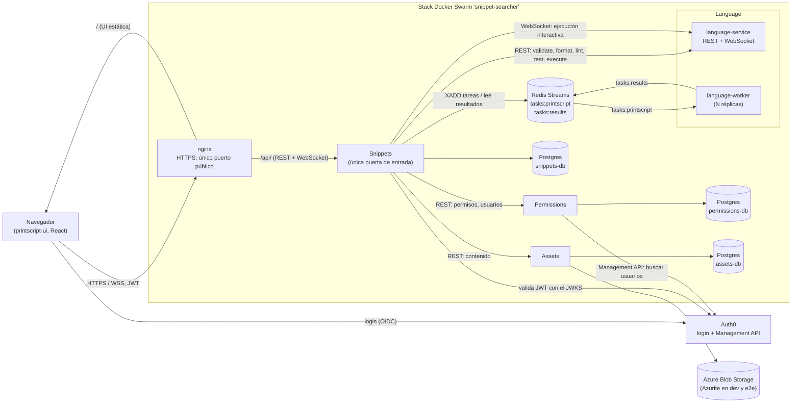
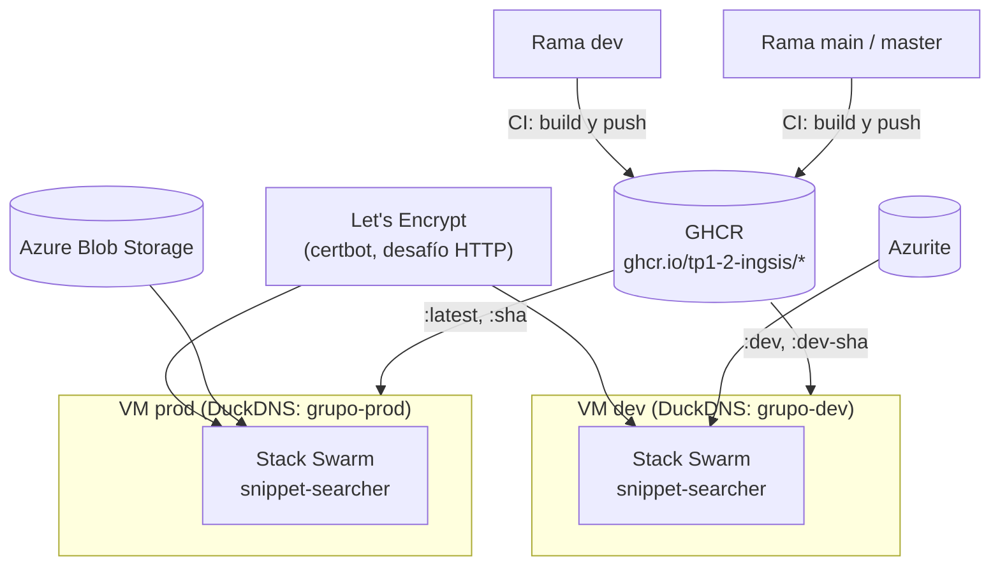

# Arquitectura de Snippet Searcher

Este documento describe la arquitectura objetivo de la plataforma: componentes, responsabilidades y despliegue. Los flujos están en [secuencias.md](secuencias.md), las historias de usuario en [user-stories.md](user-stories.md) y las decisiones en [decisiones.md](decisiones.md).

## Diagrama de componentes

Solo nginx expone puertos al exterior. Permissions, Language, Assets, Redis y las bases son internos a la red `backend` del stack. El JWT se valida únicamente en Snippets.

## Componentes

- **printscript-ui.** SPA en React que corre en el navegador. Maneja el login con Auth0, lista y edita snippets, comparte, configura reglas y abre el WebSocket para la ejecución interactiva. Solo habla con `/api/`.
- **nginx.** Reverse proxy y terminación TLS (Let's Encrypt). Sirve la UI en `/` y manda `/api/` a Snippets (quita el prefijo `/api`), con los headers `Upgrade` y `Connection` para WebSocket.
- **Snippets.** Núcleo de la plataforma y la única puerta de entrada de la UI. Valida el JWT de Auth0, guarda la metadata (nombre, descripción, lenguaje, versión, estado de validación y lint, `formatted_content`, tests, reglas) y orquesta a los demás servicios. Publica las tareas asíncronas, consume los resultados y mantiene el estado de cada tarea en su base. Hace de relay del WebSocket de ejecución.
- **Permissions.** Fuente de verdad de la autorización: quién es `OWNER` o `READ` de cada snippet. Busca usuarios en la Management API de Auth0 (`GET /users`) para el buscador de "compartir", así que no tiene tabla de usuarios propia.
- **Language.** Encapsula el motor PrintScript (artefacto CNC). Expone REST (`/languages`, `/{lang}/validate`, `format`, `lint`, `test`, `execute`) y WebSocket (`/languages/{lang}/run`). La misma imagen corre como workers (`APP_MODE=worker`) que consumen `tasks:printscript` y publican en `tasks:results`. Informa la `engineVersion` del motor en `GET /languages`.
- **Assets.** Guarda el contenido de los snippets como blobs (`/v1/assets/{snippetId}`). En prod usa Azure Blob Storage y en dev y e2e, Azurite. Su base guarda la metadata del blob. Snippets lo usa con `SNIPPET_STORAGE=assets` y `ASSETS_SERVICE_URL` (en el stack: `http://assets-service:8080`).
- **Redis Streams.** Transporte de las tareas (`tasks:printscript`) y los resultados (`tasks:results`) con grupos de consumidores. No es fuente de verdad: el estado vive en la base de Snippets.
- **Bases Postgres.** Una por servicio (`snippets-db`, `permissions-db`, `assets-db`). Ningún servicio lee la base de otro.
- **Auth0.** Autenticación (login con la SPA, JWT firmado) y directorio de usuarios, consultado por Permissions con una app Machine to Machine.

## Despliegue

- **Dos VMs, una por ambiente (dev y prod).** Cada una es su propio Swarm con el mismo nombre de stack, `snippet-searcher`, definido en `docker-stack.yml`. Los servicios se llaman `snippet-searcher_<servicio>`.
- **Dominios.** Un subdominio DuckDNS por VM (`<grupo>-dev` y `<grupo>-prod`). Certbot emite y renueva los certificados de Let's Encrypt.
- **Imágenes.** Cada repo publica en GHCR. Un push a `dev` genera `:dev` y `:dev-<sha corto>`; un push a `main` (o `master` en la UI) genera `:latest` y `:<sha corto>`.
- **CD por rama.** `dev` despliega a la VM dev y `main` a la de prod. Cada repo actualiza su servicio con `docker service update --image ...:<tag-con-sha>`, y el repo de infra hace `docker stack deploy` cuando cambia el stack. Si faltan los secrets de deploy, el paso se saltea con un aviso.
- **Secretos.** El `.env` vive solo en cada VM. Nunca se commitea.
- **Almacenamiento.** Prod usa Azure Blob Storage real y dev usa Azurite.
