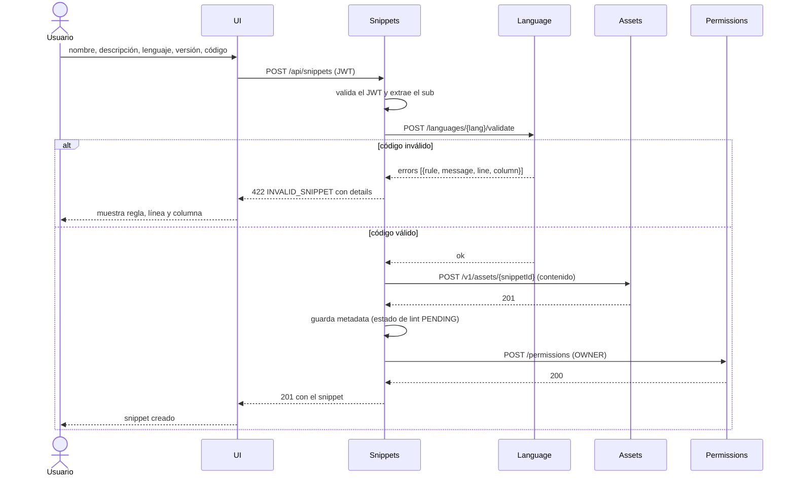
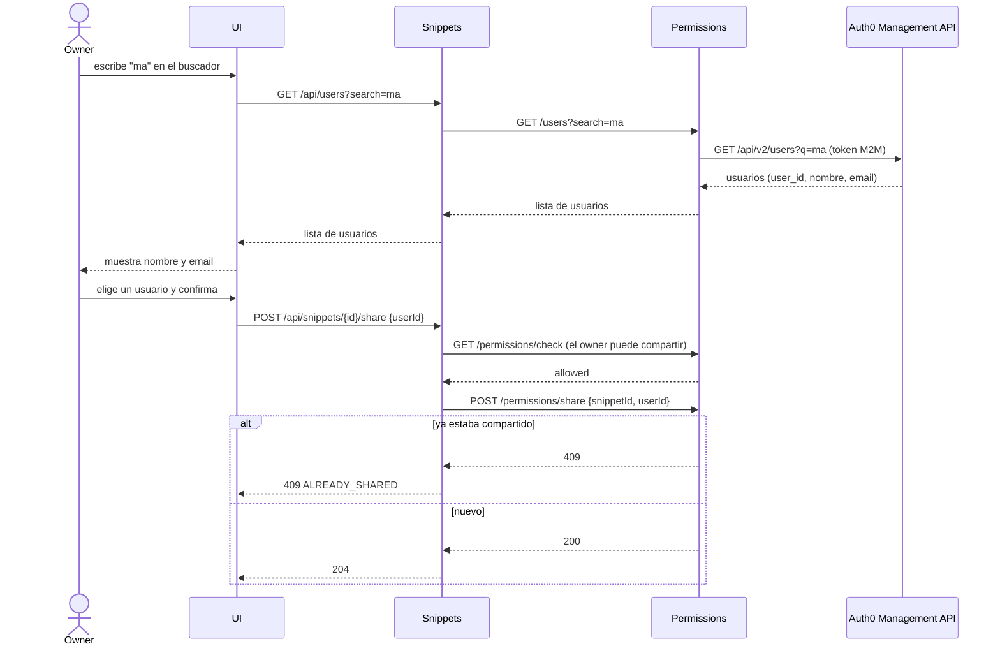
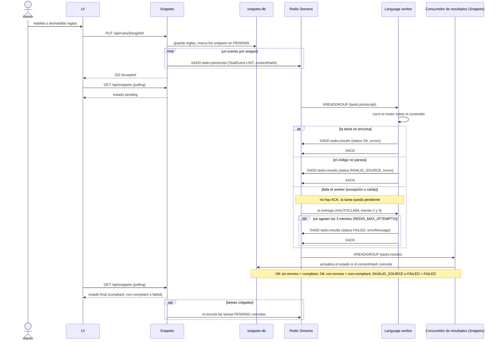
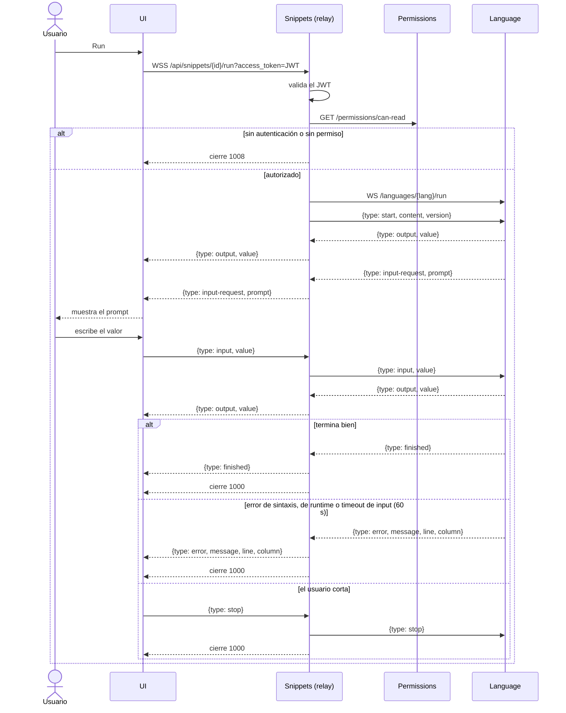
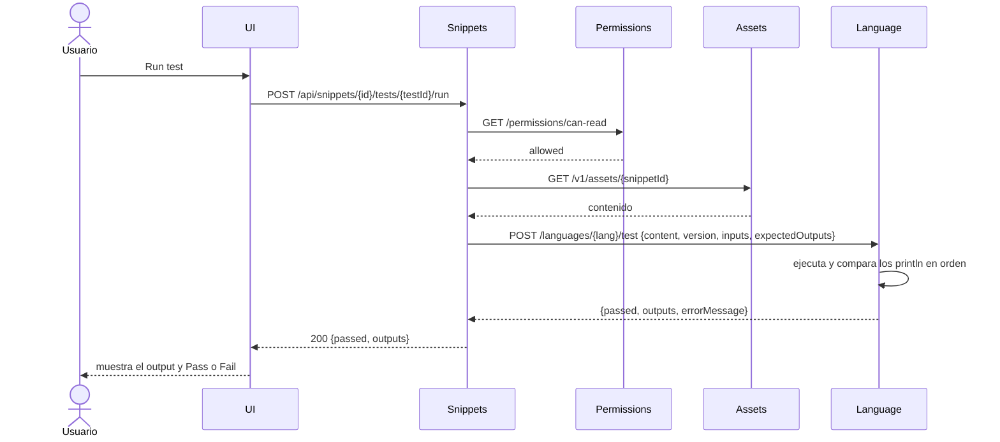
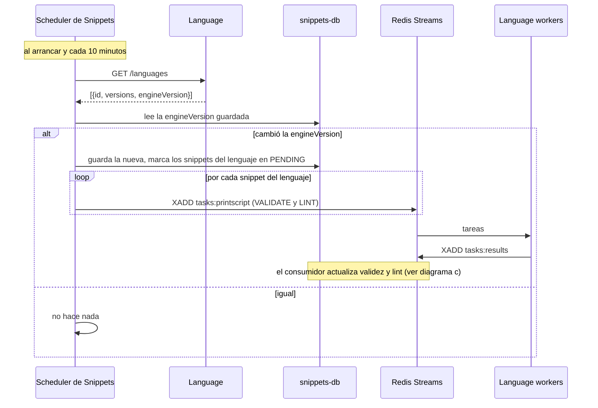

# Diagramas de secuencia

Los flujos más importantes de la plataforma. Los endpoints y mensajes son los del contrato fijado entre repos (ver [decisiones.md](decisiones.md)). Todo request a Snippets pasa antes por nginx (`/api/` → Snippets) y lleva el JWT de Auth0; para no repetirlo, los diagramas arrancan en Snippets.

## (a) Crear un snippet con validación

El usuario crea el snippet (por editor, `POST /snippets`, o por archivo, `POST /snippets/upload`). Snippets valida el código con Language antes de guardar nada. Si es inválido, responde 422 con la regla, la línea y la columna.

## (b) Compartir con búsqueda de usuarios de Auth0

Mientras el usuario escribe (con debounce de 300 ms), la UI busca usuarios. Permissions los consulta en la Management API de Auth0. Al elegir uno, Snippets verifica que quien comparte sea `OWNER` y registra el permiso de lectura.

## (c) Aplicar reglas de forma asíncrona (lint y formato)

`PUT /snippets/rules/{language}/lint` (o `/format`) guarda las reglas, deja una fila de estado por snippet y publica una tarea por snippet. Responde 202 sin esperar. Los workers de Language procesan y publican resultados; Snippets los consume y actualiza el estado. La UI consulta el listado y ve `pending` hasta que llega el resultado.

El proceso es tolerante a fallos: un snippet que falla tres veces queda en `FAILED` y el resto sigue, así que no se frena el lote. Si el contenido cambió mientras la tarea estaba en vuelo, el `contentHash` no coincide y el resultado se descarta.

## (d) Ejecución interactiva por WebSocket

La UI abre un WebSocket contra Snippets, que valida el token y el permiso y abre otro hacia Language. Snippets reenvía los mensajes en ambos sentidos. El intérprete se queda esperando cuando pide un input y cada `println` se manda al instante.

Los errores internos o el límite de 5 minutos cierran con 1011, y las violaciones del protocolo con 1008.

## (e) Correr un test

El test (inputs y outputs esperados) vive en Snippets. Para correrlo, Snippets le pide a Language que ejecute el snippet con esos inputs y compara los outputs en orden. Se corre un test a la vez.

Al editar un snippet, Snippets corre todos sus tests de forma sincrónica después de guardar. El resultado de los tests no modifica el update (US16).

## (f) Revalidación cuando cambia la versión del parser

Language informa la versión de su motor (`engineVersion`) en `GET /languages`. Snippets la compara al arrancar y cada 10 minutos. Si cambió, vuelve a encolar validación y lint de todos los snippets de ese lenguaje por el mismo mecanismo asíncrono del diagrama (c).

